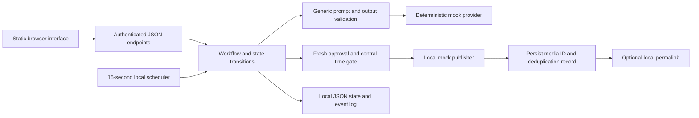

# AI Content Workflow Agent

A local, offline demonstration of structured AI content generation, human review, scheduling, and reliable workflow automation. It illustrates AI engineering, LLM adapter design, backend validation, web development, and rapid prototyping.

This standalone portfolio project is inspired by real-world content automation requirements. It uses generic implementation logic, synthetic data and mock integrations, without exposing private product information or production infrastructure. It contains no production data, credentials, proprietary prompts, internal product plans, or live publishing configuration.

## Problem and goal

AI-generated drafts need predictable structure, human approval, consistent state transitions, and duplicate prevention before automated processing. This demo makes those engineering boundaries visible through a small review workspace. It uses newly authored generic logic and synthetic examples.

## Features and stack

- Deterministic mock LLM with structured prompts, JSON validation, and topic deduplication.
- Caption editing, approval, rejection, revision, and approval revocation.
- Server-enforced schedules and terminal published states.
- Local mock publishing with durable media IDs before optional enrichment.
- Synthetic review fixtures, local publishing history, and content-free event logging.
- Authenticated JSON endpoints and a responsive, accessible vanilla web interface.
- Node.js 22+ ES modules, built-in HTTP, filesystem and crypto modules; Node's test runner.

No third-party runtime dependencies, remote assets, fonts, analytics, or build tooling are required. Package metadata and the lockfile describe the sanitized application; original cloud and rendering dependencies are omitted.

## Architecture



Only `public/` files on an explicit route allowlist are served. Drafts, captions, review data, and history are never embedded in static HTML. They are fetched from authenticated endpoints. The server binds to loopback only.

## Local installation and commands

Install Node.js 22 or newer. From this directory:

```sh
npm ci --offline --ignore-scripts --no-audit --no-fund
cp .env.example .env
# Edit the local password and session secret in .env.
npm start
```

PowerShell uses `Copy-Item .env.example .env`. If PowerShell blocks npm's script shim, use `npm.cmd` for each command. Open `http://127.0.0.1:3000` and log in with the password configured locally.

```sh
npm test
npm run check
```

Tests make loopback HTTP requests only. There are no network or live API tests. The checker validates JavaScript syntax, common credential signatures, organization markers, absolute paths, and frontend environment references. It is a focused automated check, not a guarantee that arbitrary sensitive text can be detected.

## Walk through the demo

1. On first start, the server creates invented pending-review and already-published examples in `runtime/state.json`.
2. Generate a generic topic such as “Healthy study routines”. The mock produces deterministic structured content, marked synthetic.
3. Edit the caption, choose a local date and time, and approve. Approval alone does not publish.
4. When the scheduled time arrives, the local scheduler processes the item. Alternatively, select **Process due items** or **Mock publish (due only)**. Every path enforces the same server time and approval checks.
5. Inspect the local mock media ID, history, and event log. Repeated processing cannot create a second record for the same item.
6. Revoke approval before processing to return an item to pending. Published items cannot be reapproved or edited.

Approve with a time a minute in the past for a quick local demonstration. Times entered in the browser are converted to absolute ISO timestamps; the server compares absolute times. Restarting retains JSON state. To reset, stop the server and delete only this demo's `runtime/` directory.

## Configuration and DEMO_MODE

The public demo uses a deterministic mock provider for reproducible and secure testing. The provider abstraction is designed to support server-side LLM integration through environment-based configuration.

| Variable | Behavior |
| --- | --- |
| `DEMO_MODE` | Defaults to true. Any explicitly different value stops startup. Live operation is not implemented. |
| `LLM_PROVIDER` | Defaults to `mock`. Other providers fail with a clear configuration or disabled-transport error. |
| `REVIEW_PASSWORD` | Required for all API authentication. Missing or empty means HTTP 503; login is impossible. |
| `SESSION_SECRET` | Required server-side signing secret. Missing or empty also fails closed. |
| `PORT` | Optional local port; default 3000. |
| `OPENAI_API_KEY` | Fictional placeholder in the example. Reserved server-side through `process.env.OPENAI_API_KEY`; no transport is implemented and no key is needed. |

All `.env.example` values are invented. Choose local values for the password and signing secret before running. The provider boundary is prepared for a future server-side implementation, but deliberately cannot make external calls even when a key is supplied. There is no live publishing adapter or provider switch that can enable real posting.

## Security decisions

- No original prompts, business rules, surveys, product plans, images, logos, fonts, posting history, deployment settings, or credentials are copied.
- Missing authentication configuration fails closed for login and API access. Sessions are signed, expire after one hour, and stay in browser memory.
- Every review action validates the current state. Published content is terminal.
- The latest approval and caption are read immediately before synchronous mock processing. No older runner or endpoint bypasses the centralized schedule gate.
- Mock media IDs and deduplication records are saved before permalink enrichment. A failed enrichment step cannot cause republishing on restart.
- Logs contain event codes, identifiers, and timestamps, not prompt text, captions, passwords, tokens, or provider error payloads.
- The browser uses text nodes, an external script, a restrictive content security policy, and no environment injection. API responses disable caching.
- Nested environment, cloud-state, log, cache, build, generated-content, and runtime paths are excluded by `.gitignore`.

## Limitations

This is a single-process local prototype. JSON storage is not a multi-process database, does not provide distributed transactions, and assumes a writable local filesystem. A storage failure can interrupt processing; mock effects are local and deterministic. The scheduler runs only while the server runs and processes overdue approved items on its next tick. There is no production queue, real LLM, media rendering, upload pipeline, external publishing, deployment, or learning from review feedback.

Authentication is intended for a loopback demo: no TLS, persistent login throttling, or multi-user permissions are included. Do not expose the server publicly without a separate security design. Topic deduplication normalizes letter case but does not detect semantic duplicates. State and logs are unbounded for this small demo. Input entered by a local user is not automatically anonymized; use synthetic material only.

## Verification and publication review

See `SANITIZATION.md` for the file allowlist, exclusions, and validation scope. Manually review `src/fixtures.js`, `src/provider.js`, `public/`, `.env.example`, package metadata, and this documentation before publication. Never include local `.env` or `runtime/` files. No license has been selected; this repository intentionally contains no open-source license grant.

The local `.env` is runtime configuration only and is not part of the public portfolio deliverable. Dependency directories (`node_modules`), local hosting state (`.netlify`), private audit directories, and runtime data must also be excluded. Publish only the source and documentation allowlist in `SANITIZATION.md`; `.gitignore` alone is not an export mechanism.
